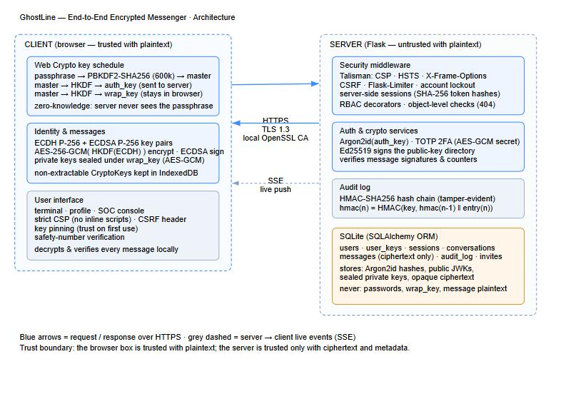
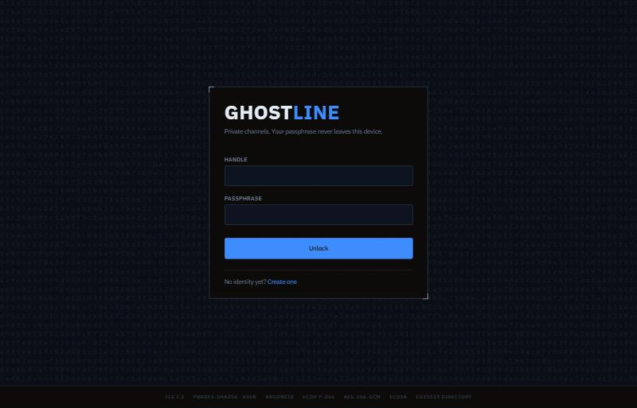
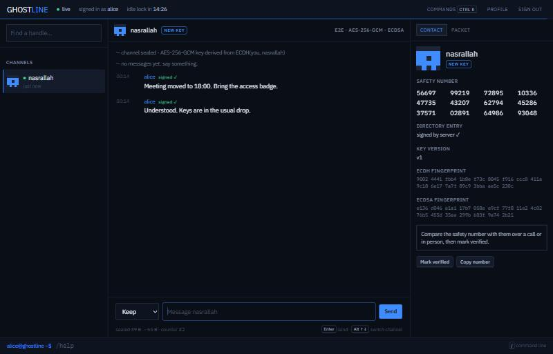
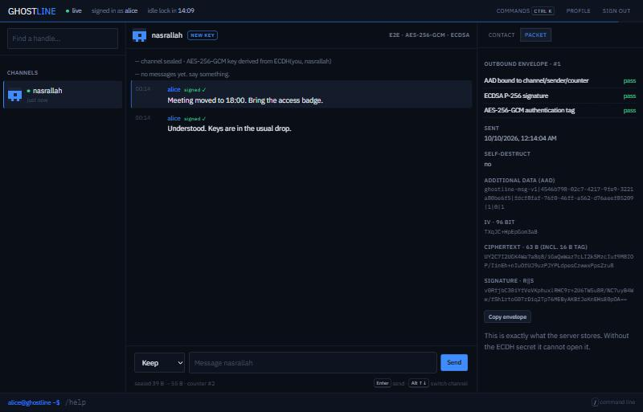
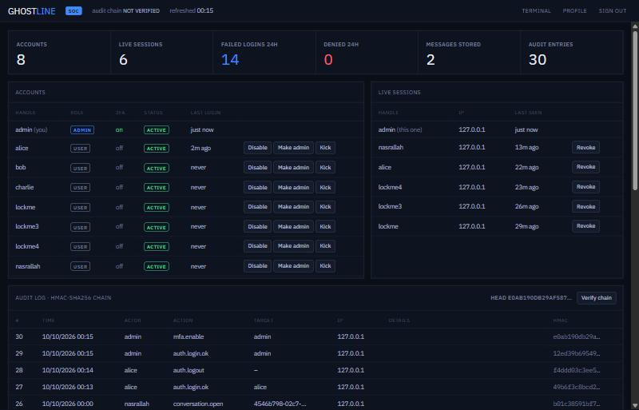

# GhostLine

**An end-to-end encrypted web messenger with zero-knowledge authentication, signed messages and a tamper-evident audit log.**

Messages are encrypted and signed in the browser with the Web Crypto API. The server stores only ciphertext. The admin (SOC) console can manage users, sessions and the audit log, but it cannot read any message.



## Overview

GhostLine is an academic project on secure authentication and applied cryptography. It is a Flask back end with a vanilla JavaScript front end and a hacker-terminal style UI. The goal was to build a working messenger in which the server is never trusted with plaintext or passphrases, then attack it with a black-box security test campaign and fix what the campaign found.

## Key features

- **Zero-knowledge authentication.** The passphrase never leaves the browser. The client derives a master key with PBKDF2-SHA256 (600,000 iterations), then derives two keys from it with HKDF: an `auth_key` that is sent to the server and a `wrap_key` that stays in the browser. The server stores only `Argon2id(auth_key)`.
- **End-to-end encryption.** Each user has an ECDH P-256 identity key for encryption and an ECDSA P-256 key for signatures. Messages use ECDH → HKDF → AES-256-GCM, and every message is signed. Private keys are sealed under `wrap_key` before upload and re-imported as non-extractable `CryptoKey`s.
- **Replay and forgery protection.** The server checks message envelopes, rejects tampered signatures and rejects replayed message counters.
- **Self-destructing messages.** Optional message TTLs (30 s, 5 min, 1 h, 24 h), enforced by a background purge worker.
- **Two-factor authentication.** TOTP (RFC 6238). TOTP secrets are encrypted at rest with AES-256-GCM. Admin accounts must enable 2FA before the SOC console unlocks.
- **Session security.** Server-side sessions with idle and absolute timeouts, token rotation, server-side revocation, account lockout after repeated failures, and rate limiting.
- **Tamper-evident audit log.** Security events are chained with HMAC-SHA256, and the admin console can verify the chain.
- **Own PKI.** An OpenSSL root CA (ECDSA P-256) issues the TLS certificate. An Ed25519 key signs the public-key directory so clients can detect key substitution.
- **Web hardening.** A strict CSP with no inline scripts, HSTS, CSRF tokens, `__Host-` cookies, `X-Frame-Options: DENY`, request size limits, and no server banner.
- **Live updates.** Server-Sent Events (SSE), with a limit on concurrent streams per user.
- **Admin SOC console.** Statistics, user management (disable, enable, unlock, change role), session revocation, audit log browsing and verification. It has no access to message content.

## Tech stack

| Layer | Technologies |
|---|---|
| Back end | Python 3.11+, Flask 3, Flask-SQLAlchemy (SQLite), Flask-WTF (CSRF), Flask-Limiter, flask-talisman |
| Crypto (server) | `cryptography` (Ed25519, AES-GCM), `argon2-cffi`, PyOTP, `qrcode` |
| Crypto (client) | Web Crypto API: PBKDF2, HKDF, ECDH/ECDSA P-256, AES-256-GCM |
| Front end | Vanilla JavaScript (no framework), Jinja2 templates, CSS, self-hosted IBM Plex fonts |
| PKI / TLS | OpenSSL (root CA, TLS server certificate, Ed25519 signing key) |
| Testing | pytest, a custom black-box campaign (`requests`, optionally through Burp Suite), OpenSSL cross-checks |

## Project structure

```
.
├── run.py                 # Starts the HTTPS server (Werkzeug, threaded for SSE)
├── config.py              # All security parameters + env-based secrets
├── requirements.txt
├── app/
│   ├── __init__.py        # App factory: CSP/HSTS, rate limiter, purge worker
│   ├── models.py          # SQLAlchemy schema
│   ├── audit.py           # HMAC-SHA256 audit chain
│   ├── events.py          # Server-Sent Events broker
│   ├── authz.py           # login_required / role_required
│   ├── server_crypto.py   # Ed25519 directory signatures
│   ├── auth/              # Registration, login, sessions, TOTP 2FA
│   ├── chat/              # Conversations, envelope validation, live stream
│   ├── admin/             # SOC console API
│   ├── static/            # crypto.js, keystore.js, terminal.js, ... (no inline scripts)
│   └── templates/         # login, register, terminal, profile, admin, errors
├── clientsim/             # Python reference implementation of the browser crypto
├── scripts/
│   ├── gen_certs.sh       # Root CA + TLS cert + Ed25519 key  -> certs/
│   ├── gen_secrets.sh     # Fresh random secrets              -> .env
│   ├── seed.py            # Demo accounts (random passphrases)
│   ├── reset_2fa.py       # Re-issue a TOTP secret for an account
│   └── pentest/           # campaign.py, openssl_verify.py
├── tests/                 # pytest suite
└── docs/
    ├── architecture.svg / .jpg
    ├── evidence/          # Security campaign logs + OpenSSL verification artefacts
    └── screenshots/       # Application screenshots
```

## Getting started

### Prerequisites

- Python 3.11 or later
- OpenSSL on your `PATH` (`openssl version`)
- A POSIX shell for the setup scripts (Git Bash on Windows)

### Install

```bash
git clone https://github.com/Nasrallah-Hadhri/ghostline-e2ee-messenger.git
cd ghostline-e2ee-messenger

python -m venv .venv
# Linux / macOS
source .venv/bin/activate
# Windows (Git Bash)
source .venv/Scripts/activate

pip install -r requirements.txt
```

### Configure

```bash
bash scripts/gen_certs.sh      # root CA, TLS certificate and Ed25519 signing key -> certs/
bash scripts/gen_secrets.sh    # writes .env with fresh 256-bit random secrets
python scripts/seed.py --reset # optional: demo accounts admin, alice, bob, charlie
```

`.env.example` documents every variable. Never commit `.env` or anything in `certs/`. Both are git-ignored.

`seed.py` generates random passphrases and writes them to `instance/seed_credentials.txt`, which is git-ignored. No credentials are hard-coded. The admin account has to enable 2FA from its profile page before the SOC console unlocks.

### Run

```bash
python run.py
```

Open **https://localhost:5443**. To get a trusted padlock, import `certs/ca.crt` into your OS or browser trust store first. To exchange messages, sign in as two different users in two browser profiles, or use `localhost` and `127.0.0.1`.

### Tests

```bash
python -m pytest -q
```

The suite covers authentication, sessions, authorization, the audit chain, messages, 2FA, security headers and regression tests for each pentest finding. It does not need a `.env`, because the test configuration uses throwaway keys.

### Security test campaign

These black-box tests run against a live instance and write their evidence to `docs/evidence/`:

```bash
python scripts/pentest/campaign.py                                           # trusts our CA
python scripts/pentest/campaign.py --proxy http://127.0.0.1:8080 --insecure  # through Burp Suite
python scripts/pentest/openssl_verify.py                                     # independent OpenSSL checks
```

## Screenshots

| Login | Encrypted terminal |
|---|---|
|  |  |
| **Message packet inspector** | **SOC console (admin)** |
|  |  |

## Results

These results come from the project's own evidence files in `docs/evidence/`:

- **Week 4 campaign** ([summary.txt](docs/evidence/campaign/summary.txt)): 13 tests passed (SQL injection, enumeration, session fixation, cookie reuse, CSRF, IDOR, privilege escalation, mass assignment, XSS, forged and replayed messages, 2FA bypass, unauthenticated streams), 4 findings were raised and 1 test was skipped.
- **Week 5 fixes** ([after-fixes.txt](docs/evidence/campaign/after-fixes.txt)): brute force now triggers account lockout (HTTP 423), oversized bodies are rejected (HTTP 413), and the server banner is gone. The per-finding regression tests in `tests/test_findings.py` went from 9 xfail to 13 passing.
- **OpenSSL cross-checks** ([summary.txt](docs/evidence/openssl/summary.txt)): OpenSSL independently verifies message and directory signatures, reproduces the audit HMAC construction, and confirms TLS 1.3 with `TLS_AES_256_GCM_SHA384` from the project CA.

## Limitations

- The passphrase policy is enforced client-side only, because the server never sees the passphrase.
- Metadata (who talks to whom, and when) is visible to the server.
- First contact is trust-on-first-use. Compare safety numbers or fingerprints to be sure.
- There is no forward secrecy (no Double Ratchet). This is a possible extension.
- Detecting audit-log tail truncation needs an external anchor.
- The bundled server is the Werkzeug development server. A real deployment would sit behind a hardened WSGI server and reverse proxy.

## Academic context

This was a mini-project for the course *L'Art de la Protection du Secret* (Project 2, "Secure authentication and cryptography system"). It was built during the ING-5 SSIR (cybersecurity engineering) track at **TEKUP**, Tunisia, in the 2026–2027 academic year.

## Author

**Nasrallah Hadhri**: [github.com/Nasrallah-Hadhri](https://github.com/Nasrallah-Hadhri)

## License

The code is released under the [MIT License](LICENSE). The IBM Plex fonts are under the SIL Open Font License (`app/static/fonts/LICENSE-IBMPlex.txt`).
